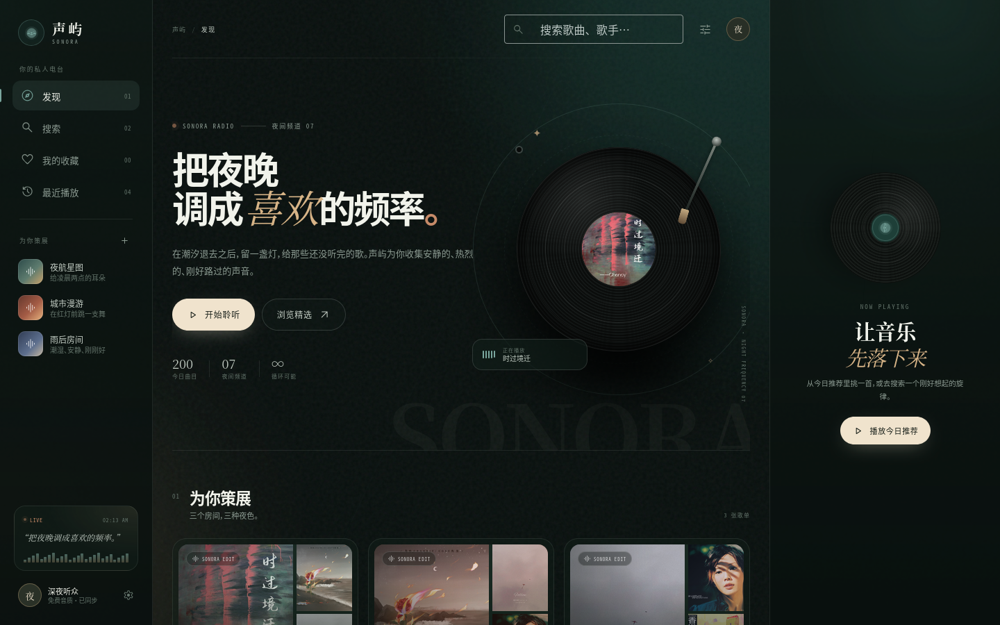
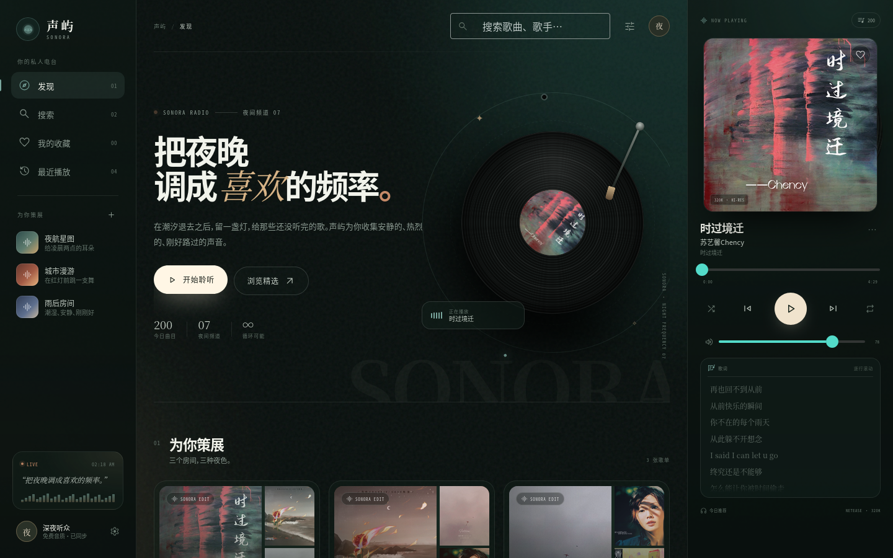
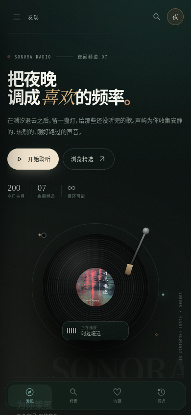
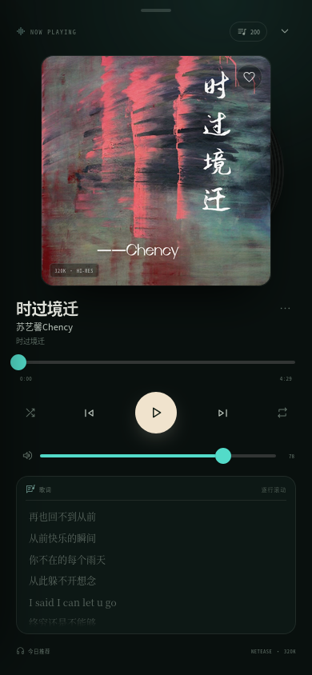
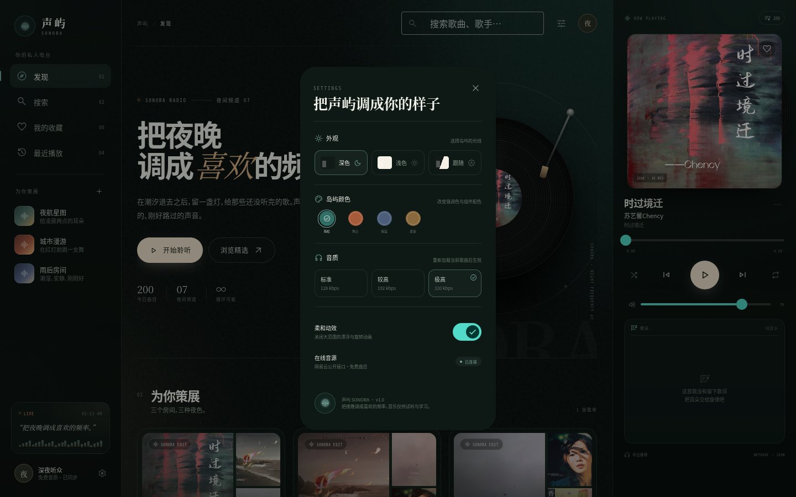

# 声屿 SONORA

一个以「深夜音乐岛屿」为概念的在线音乐播放器。界面完全基于 **mdui 2.1.5** 组件与 Material Design 3 设计语言搭建，在线曲库来自网易云音乐公开接口。

<sub>更新随缘，详见文末「关于更新」。</sub>



## 界面



<p>
  
  
  
</p>

## 运行

```bash
npm install
npm run dev      # http://localhost:5173
npm run build    # 生产构建，输出到 dist/
npm run preview  # 预览生产构建
```

### 接口代理

音乐接口不再返回 `Access-Control-Allow-Origin`，浏览器直连会被 CORS 拦截，因此前端统一请求同源的 `/gdapi/api.php`：

- `npm run dev` / `npm run preview` 由 `vite.config.js` 把 `/gdapi/*` 转发到 `https://music-api.gdstudio.xyz/*`；可用环境变量 `SONORA_API_ORIGIN` 换成自己的上游或自建代理。
- 静态部署（把 `dist/` 丢到任意服务器）需要在该服务器上把 `/gdapi/` 反代到同一个上游；不方便加反代时，用 `VITE_API_BASE` 指向一个已允许跨域的接口地址再构建：

```bash
SONORA_API_ORIGIN=https://your-proxy.example.com npm run dev
VITE_API_BASE=https://your-proxy.example.com/api.php npm run build
```

## Android App

网页版用 **Capacitor 8** 套成原生 App：WebView 加载打包后的 `dist/`，启用 `CapacitorHttp` 让接口请求走原生（绕过第三方接口的 CORS 限制），并补了图标、启动图与 Android 15 的 edge-to-edge 适配。细节见 [ANDROID.md](ANDROID.md)。

```bash
npm run build:android   # vite build --mode android && cap sync android
cd android && ./gradlew assembleDebug
# 产物：android/app/build/outputs/apk/debug/app-debug.apk
```

Windows 上也可以直接双击 `build-apk.cmd`（需要 JDK 21 + Android SDK，脚本会把仓库外的工具链路径指给 Gradle）。

## 设计

- **品牌**：声屿 / SONORA，把夜晚调成喜欢的频率。
- **色彩**：默认深色 MD3，以深青绿 `#2F6F66` 为种子色动态生成配色，叠加奶油、杏色、陶土与少量金色；支持浅色与跟随系统。
- **布局**：桌面三栏（侧边栏 / 编辑式内容区 / 正在播放面板）；小于 1280px 收起右栏并显示迷你播放条；小于 840px 切换为底部导航与全屏播放页。
- **组件**：mdui-text-field、mdui-slider、mdui-switch、mdui-dialog、mdui-circular-progress、mdui 图标按钮等，辅以自定义 CSS 完成大圆角、色调表面、黑胶与光晕动效。
- **图标**：本地打包的 Material Symbols Rounded SVG sprite，无字体 CDN 依赖。

## 功能

- 热歌榜 / 新歌榜 / 飙升榜，今日推荐、心情与曲风筛选、编辑精选歌单。
- 在线搜索（歌曲 / 歌手），搜索建议、封面异步补全、骨架屏。
- 完整播放器：播放暂停、上下曲、随机、循环、进度拖动、音量、队列管理、Media Session。
- 歌词解析与逐行高亮、收藏、最近播放、播放队列。
- 设置：深色 / 浅色 / 跟随、4 套种子色、音质选择、柔和动效。
- 响应式桌面 / 平板 / 手机布局，键盘 `/`、空格、Esc 快捷键。

## 结构

```text
index.html
src/
  main.js       # 状态、视图、播放器与交互
  styles.css    # MD3 tokens、三栏布局、动效与响应式
  api.js        # 在线搜索、榜单、播放地址、封面、歌词
  data.js       # 品牌常量、种子色、心情/曲风、回退曲目
  icons.js      # 本地 SVG sprite
  icons/        # Material Symbols Rounded SVG
```

## 说明

音乐接口为第三方公开聚合服务（`music-api.gdstudio.xyz`），仅用于学习与试听；版权受限或需要付费的曲目可能无法获取播放地址。播放器未登录，仅请求免费音源。

## 关于更新

这个项目是一次「想做就做了」的产物——想法、代码与截图，大多是和 AI agent 一句一句聊出来的。它谈不上工程上的严谨，也因此留了点手作的气息。

所以更新的节奏就随缘了：有空、有灵感的时候，也许会添一两个小功能；也可能就停在这里，不再往前走了。眼下这一版是完整、能用的——如果它恰好就是最后一版，也请不必意外。

遇到问题欢迎开个 issue 说说，我会看，只是不保证回应的快慢；也欢迎你 fork 一份，按自己的心意改下去。它本来就是为了「喜欢」而做的，能被别人接着喜欢，是件挺好的事。
